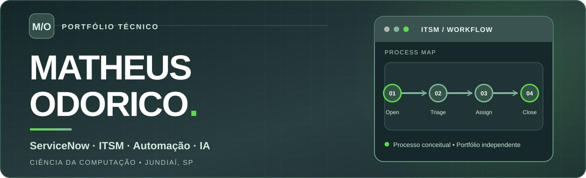
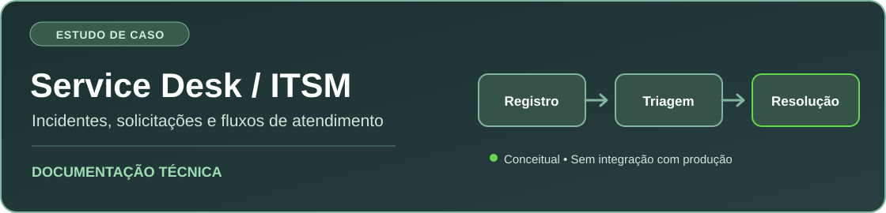

  

  <strong>ServiceNow & ITSM</strong> · <strong>Service Desk</strong> · <strong>Workflow Automation</strong> · <strong>Generative AI</strong>

  <a href="https://www.linkedin.com/in/matheus-odorico-09a027216">LinkedIn</a>
  &nbsp;&nbsp;•&nbsp;&nbsp;
  <a href="./docs/estudo-de-caso-itsm.md">Estudo de caso ITSM</a>
  &nbsp;&nbsp;•&nbsp;&nbsp;
  <a href="https://github.com/Mathzz0?tab=repositories">Repositórios</a>

---

### Olá, sou o Matheus.

Sou graduando em **Ciência da Computação na UniAnchieta** (período noturno, conclusão prevista para **dezembro de 2027**) e concluí uma **formação profissional em ServiceNow pela Facul IV2**.

Meu objetivo é atuar em **TI**, especialmente com **ServiceNow, IT Service Management (ITSM), Service Desk, suporte técnico e automação de processos**. Tenho experiência profissional com **CRM, organização de fluxos e operações técnicas** e desenvolvo projetos de aplicativos, sites e jogos com auxílio de **IA generativa**.

### Foco técnico

| Área | Conhecimentos e atividades |
| :-- | :-- |
| **ServiceNow / ITSM** | Formação concluída; fundamentos de gerenciamento de serviços e processos de atendimento |
| **Suporte e processos** | CRM, suporte técnico, documentação, organização operacional e resolução de problemas |
| **Automação e IA** | ChatGPT, Claude, Codex, engenharia de prompts e desenvolvimento assistido por IA |
| **Desenvolvimento** | Aplicativos, sites, Roblox Studio, lógica de jogos, testes e prototipação |
| **Aviação executiva** | Suporte técnico-operacional e atualização de bases de dados aeronáuticas Garmin |

**Temas em aprofundamento:** Incident Management · Request Management · Flow Designer · Service Catalog · CMDB · SLA · Knowledge Management. *Tópicos de estudo, não certificações adicionais nem experiência de implantação em produção.*

### Projeto em destaque — triagem ITSM

**[Ver documentação, diagrama de fluxo e critérios de teste](./docs/estudo-de-caso-itsm.md)**  
**[Código Python](./examples/itsm_triage.py)** · **[Testes unitários](./examples/test_itsm_triage.py)** · **[Pipeline GitHub Actions](./.github/workflows/itsm-tests.yml)**

Pequeno protótipo educacional **executável**, com regras ilustrativas de prioridade, encaminhamento de incidentes e validação de entradas. O exemplo foi validado com **7 testes unitários**, sem dependências externas. **Não é uma integração com o ServiceNow.**

### Outros projetos

- **Jogo multiplayer no Roblox Studio** — mecânicas, interface, progressão, inventário e testes. *Código privado / em desenvolvimento.*
- **Aplicativos, sites e sistemas com IA** — projetos desenvolvidos com assistência de modelos generativos. *Demonstrações públicas em preparação.*

### Formação

- **Ciência da Computação — UniAnchieta** · 2024–2027 · período noturno · conclusão prevista para **dez/2027**.
- **Formação Profissional em ServiceNow — Facul IV2** · concluída.
- **Power BI e Power Automate — Microsoft Learn** · estudos planejados, ainda não apresentados como concluídos.

---

  <strong>Em busca de oportunidades para desenvolver minha carreira em TI.</strong>
   
  <a href="https://www.linkedin.com/in/matheus-odorico-09a027216">Conecte-se comigo no LinkedIn</a>

Identidade visual autoral inspirada em tons associados à ServiceNow. Portfólio pessoal independente, sem afiliação ou endosso da empresa.
