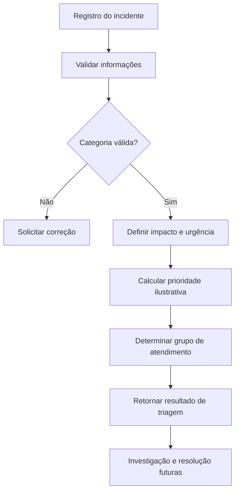

# Estudo de caso: triagem de chamados de TI (ITSM)

**Tema:** Service Desk · Incident Management · IT Service Management (ITSM) · Workflow Automation  
**Status:** documentação conceitual + protótipo educacional **executável e testado** em Python.  
**Limites:** não é uma aplicação instalada no ServiceNow e não acessa APIs, contas, chamados reais ou dados de terceiros.

## 1. Problema e objetivo

Em operações de Service Desk, incidentes chegam com diferentes graus de impacto e urgência. Uma triagem consistente ajuda a definir a prioridade inicial e encaminhar o registro para o grupo adequado.

Este estudo demonstra uma abordagem pequena, determinística e auditável para essa primeira etapa. **Não pretende reproduzir todas as regras de ITIL ou de uma instância ServiceNow.**

## 2. Fluxo proposto



O protótipo executável cobre **validação, classificação e encaminhamento inicial**. Investigação, notificações, SLA, aprovação e encerramento são temas de evolução, **não funcionalidades implementadas**.

## 3. Modelo simplificado

| Campo | Tipo | Descrição |
| --- | --- | --- |
| `category` | texto | `access`, `hardware` ou `software` |
| `impact` | inteiro 1–3 | 1 representa maior impacto |
| `urgency` | inteiro 1–3 | 1 representa maior urgência |
| `assignment_group` | texto | Grupo fictício definido pela categoria |
| `priority` | texto | P1 a P4, conforme matriz ilustrativa |
| `state` | texto | `new`, estado inicial do exemplo |

### Matriz de prioridade do protótipo

| Impacto ↓ / Urgência → | 1 (alta) | 2 (média) | 3 (baixa) |
| --- | :---: | :---: | :---: |
| **1 (alto)** | P1 | P2 | P3 |
| **2 (médio)** | P2 | P3 | P4 |
| **3 (baixo)** | P3 | P4 | P4 |

**Atenção:** esta matriz é fictícia. Não define SLAs, política oficial de prioridade, regras de produção ou uma configuração padrão ServiceNow.

## 4. Código funcional (Python)

Fonte: **[examples/itsm_triage.py](../examples/itsm_triage.py)**  
Testes: **[examples/test_itsm_triage.py](../examples/test_itsm_triage.py)**

O código utiliza apenas a biblioteca padrão do Python (3.10+) e não requer instalação de pacotes nem credenciais.

Execute na raiz do repositório:

```bash
python3 examples/itsm_triage.py --category access --impact 1 --urgency 2
```

Saída esperada:

```json
{
  "category": "access",
  "assignment_group": "Identity & Access",
  "impact": 1,
  "urgency": 2,
  "priority": "P2",
  "state": "new"
}
```

Para rodar os testes:

```bash
python3 -m unittest discover -s examples -p "test_*.py" -v
```

**Cobertura:** nove combinações de prioridade; normalização da categoria; roteamento; entradas inválidas; estado inicial e interface de linha de comando. Os **sete métodos de teste** foram executados com sucesso no ambiente de desenvolvimento antes da publicação.

## 5. Próximas etapas de aprendizado

- Estudar a configuração real de **Incident Management** e **Request Management** no ServiceNow.
- Experimentar **Flow Designer**, **Service Catalog**, **CMDB**, **SLA** e **Knowledge Management** em ambiente educacional.
- Registrar capturas, scripts e evidências somente depois de implementados e testados.
- Revisar as regras de negócio com o contexto da empresa antes de qualquer uso real.

## 6. Segurança e transparência

O exemplo usa categorias, equipes e dados **fictícios**. Não há tokens, segredos, chamadas de rede, integração com banco de dados nem dados pessoais. Este material é parte de um portfólio independente, **não afiliado nem endossado pela ServiceNow**.

---

[← Voltar ao perfil de Matheus Odorico](../README.md) · [LinkedIn](https://www.linkedin.com/in/matheus-odorico-09a027216)
