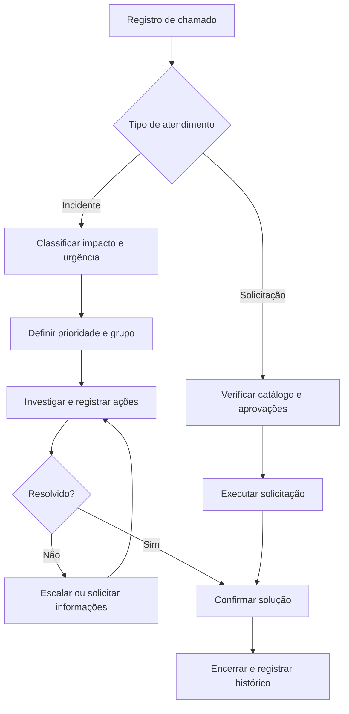

# Estudo de caso | Fluxo de atendimento ITSM

> **Status: estudo conceitual para portfólio.** Este material descreve uma proposta de processo de Service Desk e **não representa uma implementação concluída no ServiceNow**. O cenário e os registros apresentados são fictícios; não contêm dados de clientes.

## 1. Problema

Uma equipe de suporte recebe incidentes e solicitações por diferentes canais. Sem classificação padronizada, é difícil priorizar, atribuir responsabilidades e acompanhar o andamento dos chamados.

**Objetivo:** propor um fluxo simples, rastreável e orientado a boas práticas de gerenciamento de serviços de TI.

## 2. Fluxo proposto

## 3. Dados mínimos de um incidente

| Campo | Finalidade |
| --- | --- |
| Número | Identificação única do registro |
| Solicitante | Pessoa ou área afetada, usando dados de teste |
| Descrição breve | Resumo claro do problema |
| Categoria / subcategoria | Classificação para roteamento e relatórios |
| Impacto + urgência | Insumos para a definição da prioridade |
| Grupo responsável | Equipe encarregada do atendimento |
| Estado | Novo, Em andamento, Aguardando, Resolvido, Encerrado |
| Histórico de trabalho | Registro das ações, atualizações e encaminhamentos |
| Resolução | O que foi feito e como a solução foi validada |

## 4. Regras e automações candidatas

1. **Classificação inicial:** coletar categoria, impacto e urgência no cadastro do incidente.
2. **Roteamento:** atribuir o grupo correto a partir do tipo de chamado, com possibilidade de correção manual.
3. **Notificações:** informar o solicitante sobre mudanças relevantes de estado.
4. **Escalonamento:** sinalizar chamados perto do prazo de atendimento definido pela organização.
5. **Encerramento:** solicitar confirmação quando aplicável e manter histórico de resolução.

> Prazos de SLA, regras de prioridade e requisitos de aprovação dependem do serviço e da política da organização. Não há prazos de produção definidos neste estudo.

## 5. Casos de teste sugeridos

- **CT-01:** um incidente novo recebe número, estado e classificação válidos.
- **CT-02:** alterar impacto/urgência atualiza a prioridade conforme a matriz configurada.
- **CT-03:** a atribuição encaminha o chamado ao grupo correto e preserva o histórico.
- **CT-04:** um incidente sem solução pode ser escalado sem perder registros anteriores.
- **CT-05:** uma solicitação segue seu fluxo específico de aprovação/execução, sem ser tratada como incidente.

## 6. Próximos passos para implementação

- Prototipar o processo em uma instância de aprendizado do ServiceNow.
- Documentar tabelas, formulários e regras realmente implementadas.
- Executar os testes com dados fictícios e capturar evidências.
- Publicar resultados e limitações **somente depois da validação prática**.

---

**Autor do portfólio:** [Matheus Odorico](https://github.com/Mathzz0) · [LinkedIn](https://www.linkedin.com/in/matheus-odorico-09a027216)  
**Natureza:** estudo educacional e conceitual, sem integração com sistemas de produção.
